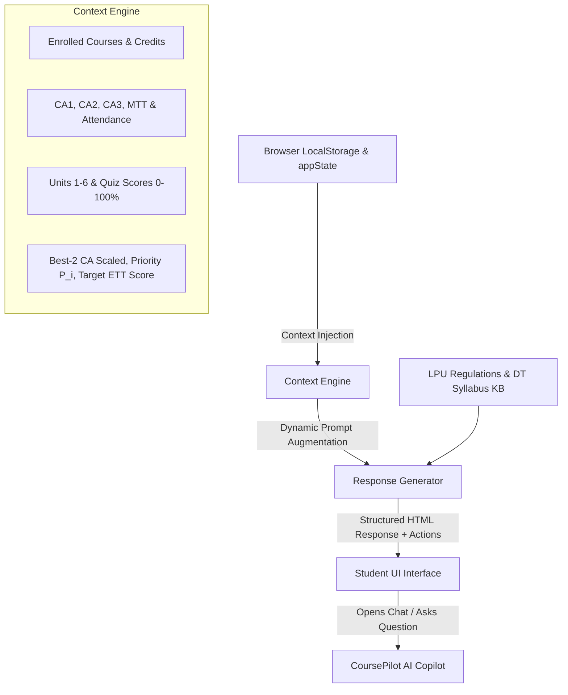

# CoursePilot AI Copilot: Architecture & Query Knowledge Base

## Overview
The **CoursePilot AI Copilot** is a personalized conversational intelligence layer embedded directly into the CoursePilot platform. Unlike generic third-party chatbots, the Copilot has real-time read access to the student's active session state (`appState`), enabling it to answer academic, algorithmic, and institutional questions with contextual precision.

---

## 1. System Architecture & State Connection

---

## 2. Supported Student Query Categories & Capabilities

### Category A: Diagnostic & Personalized Study Recommendations
- **"What should I study right now / tonight?"**
  - *Context Used:* $P_i = 0.5W_i + 0.3E_i + 0.2S_i$ across all enrolled units.
  - *Output:* Top 3 highest-risk units, days remaining to exam, and a one-click button to apply a 120-minute study budget directly to the live planner.
- **"Which subjects are leaking my internal marks?"**
  - *Context Used:* Internal percentage vs. average unit weakness.
  - *Output:* Ranked course risk breakdown highlighting the exact chapters responsible for grade loss.

### Category B: LPU Academic Policies & Marks Computation
- **"How are my internal marks calculated?"**
  - *Explanation:* Details the LPU continuous assessment model—CA1, CA2, CA3 (Best 2-of-3 applied, scaled to 30) + Mid-Term Examination (30 marks) = 60 total internal standing. Explains that a poor CA1 can be salvaged by strong CA2/CA3 performances.
- **"How much do I need in End-Term (ETT) to get an A+ or O grade?"**
  - *Calculation:* Evaluates the current internal score out of 60 against target letter grade cut-offs (O: $\ge 90$, A+: $\ge 80$, A: $\ge 70$, B+: $\ge 60$) and outputs the exact required score out of 100 on the ETT.
- **"Is my attendance safe from debarment?"**
  - *Policy:* Audits attendance across all courses against the mandatory 75% threshold. Advises on medical/duty leave submission protocols and points out the 85% and 90% attendance bonus mark tiers.

### Category C: Algorithmic Transparency
- **"How does the priority formula work?"**
  - *Formula:*
    $$P = 0.5 \times W + 0.3 \times E + 0.2 \times S$$
    Breaks down Weakness ($100 - \text{Score}$), Urgency ($\text{Days to Exam}$), and Pending Syllabus, explaining why time blocks are bounded between 20 and 50 minutes to prevent cognitive fatigue.

### Category D: INT335 Design Thinking Viva & Coursework Assistance
- **"Give me INT335 viva tips"**
  - *Guidance:* Prepares the student for the mandatory 2-minute individual viva:
    1. Explaining the team's POV statement and why CoursePilot was chosen over rejected ideas.
    2. Defending their signed Annexure C contribution (interviews, AEIOU observations, feedback matrices).
    3. Reminding them that 45 out of 100 marks depend on research and testing evidence, not coding beauty.

### Category E: Platform Help & Data Management
- **"Does CoursePilot save my data if I close the tab?"**
  - *Explanation:* Confirms real-time auto-saving to browser `localStorage` and guides the student on using the "Reset LPU Sample Data" button if they wish to start fresh.

---

## 3. How to Access the Live Chatbot

1. Open the live CoursePilot platform in any browser: **`http://localhost:8000/index.html`**
2. In the bottom-right corner, click the floating **"Ask AI Copilot"** button.
3. Use the horizontal quick suggestion chips or type any natural language question.
